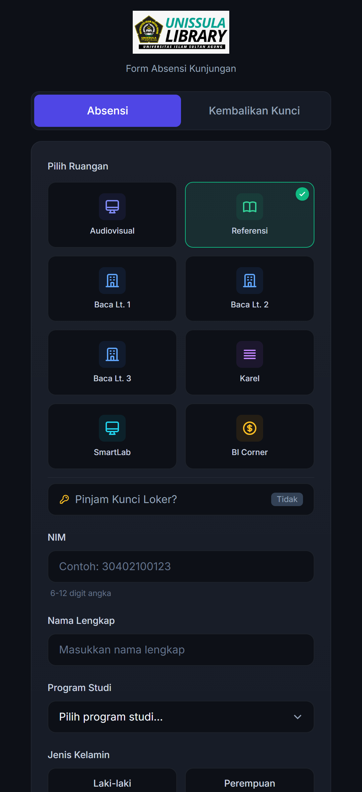
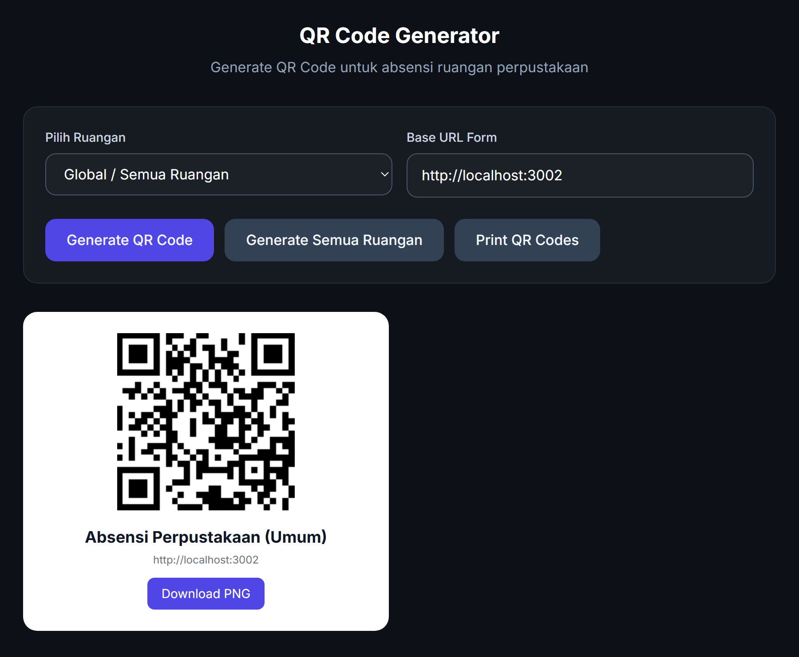

# 📱 Form Absensi — Perpustakaan UNISSULA

<div align="center">

**Aplikasi Form Absensi Mandiri untuk Pengunjung Perpustakaan UNISSULA.**


</div>

Pengunjung cukup memindai QR code yang ditempel di tiap ruangan, lalu mengisi form di HP. Ruangan langsung
tercentang sesuai QR yang dipindai, dan data kunjungan dikirim ke backend
[dashboard analytics perpustakaan](https://github.com/alvahraa/prototype-dashboard) untuk diolah jadi statistik.

## 📸 Tampilan

<p align="center">
  
  &nbsp;&nbsp;
  
</p>
<p align="center"><sub>Kiri: form absensi dibuka dari QR ruangan Referensi. Kanan: generator QR code per ruangan (<code>qr-generator/</code>).</sub></p>

---

## 🚀 Fitur Utama

- **Pilihan Ruangan Tersedia**: Pengunjung dapat memilih ruangan yang dituju secara langsung (Audiovisual, Referensi, Baca Lt. 1-3, Karel, SmartLab, BI Corner).
- **Scan QR Code Ruangan**: Otomatis mencentang ruangan jika diakses melalui hasil scan QR Code khusus ruangan (parameter `?room=kode_ruangan`).
- **Peminjaman & Pengembalian Kunci Loker**: Mendukung alur peminjaman loker untuk penitipan barang dan pengembalian kunci mandiri.
- **Identifikasi Pengunjung**: Kolom pencatatan NIM, Nama, Prodi/Fakultas, Jenis Kelamin, dan Umur.
- **Generator QR Code**: Halaman `qr-generator/` membuat, mengunduh, dan mencetak QR code untuk tiap ruangan.

---

## 🛠️ Cara Penggunaan (Deployment/Hosting)

Form absensi ini adalah aplikasi frontend mandiri berbasis HTML, CSS, dan JavaScript Vanilla (Tanpa framework JSX/React).

Anda cukup **menghosting (deploy)** isi dari repositori ini ke layanan hosting statis manapun seperti:
- **Vercel** (Cukup hubungkan repo GitHub dan deploy, tidak perlu build settings khusus)
- **Netlify**
- **GitHub Pages**
- Server Apache / Nginx / cPanel (Cukup upload semua file ke dalam folder `public_html` atau direktori web yang sesuai).

### ⚙️ Konfigurasi Koneksi ke Backend (Dashboard)

Agar absensi berhasil dikirim ke server dashboard utama, pastikan untuk mengubah koneksi API di file `script.js`.

Buka file **`script.js`**, lalu perhatikan baris konfigurasi di bagian atas:

```javascript
const API_CONFIG = {
    // Ubah URL ini menjadi URL dari backend Dashboard Perpustakaan Anda
    // Contoh: 'https://backend-dashboard-anda.up.railway.app/api'
    baseUrl: 'https://backend-perpus.vercel.app/api', 
    useMockData: false
};
```

Ganti nilai `baseUrl` dengan link/domain API production dari server instalasi Dashboard Utama.

---

## 📝 Lisensi

Aplikasi Form Absensi ini merupakan bagian dari sistem manajemen perpustakaan yang dikembangkan khusus untuk UNISSULA.  
Perpustakaan UNISSULA memiliki **hak penuh** untuk menggunakan, menginstal, memodifikasi, dan mengembangkan perangkat lunak ini.

Lihat file [LICENSE](./LICENSE) untuk detail lengkap.

---

<div align="center">

**Dikembangkan oleh Alvah Rabbany**  
Email: alvahrabbany22@gmail.com | GitHub: [alvahraa](https://github.com/alvahraa)  
untuk **Perpustakaan Universitas Islam Sultan Agung (UNISSULA)**

(c) 2026 Alvah Rabbany

</div>
